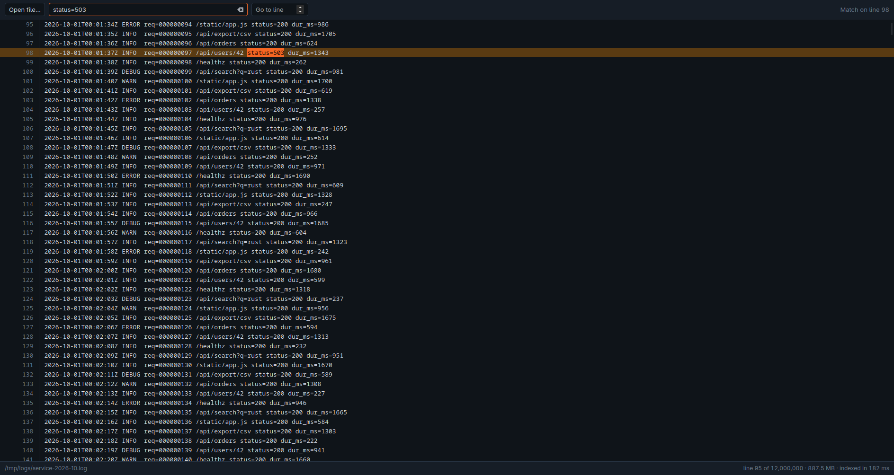

# bigview

A desktop viewer that opens text, log and CSV files of any size without
loading them into memory. Built with Rust and Tauri 2.

Most editors read the whole file before showing the first line, which makes
multi-gigabyte logs slow or impossible to open. bigview memory-maps the file,
builds a small line index once, and afterwards only ever touches the bytes of
the lines on screen.



## What it does

- Opens a file and shows it immediately; scrolling, Page Up/Down, Home/End.
- Jump to any line number.
- Find next match across the whole file, with matches highlighted.
- Handles `\n` and `\r\n` endings, invalid UTF-8, and very long lines (cut to
  4096 bytes on screen and marked).

## How it works

- `core/`: the `bigview-core` crate. The file is memory-mapped read-only. A
  sparse index stores the byte offset of every 1024th line (about 8 KiB of
  index per million lines). Locating a line is one index lookup plus a scan
  over at most 1023 newlines; search is a `memchr::memmem` scan mapped back to
  a line number through the same index.
- `app/src-tauri/`: the Tauri shell, `open_file` (indexes on a blocking
  thread and emits progress events), `get_lines`, `find_next`.
- `app/ui/`: plain HTML/CSS/JS, no framework or bundler. The list is
  virtualized: only the visible rows exist in the DOM. Browsers cap element
  heights, so beyond 8 million pixels the scrollbar maps proportionally onto
  the line range and the mouse wheel is handled in lines.

## Measured

930 MB synthetic service log, 12,000,000 lines, release build, file already in
the page cache (three runs, Linux, 12 threads available, single-threaded code):

| Operation | Time |
|-----------|------|
| Build the line index | 184-215 ms (4.3-5.1 GB/s) |
| Read the last 40 lines | 23-27 µs |
| Search to a match 5 lines from the end | 66-69 ms |

A cold cache is bounded by disk read speed instead. Reproduce with:

```
cargo run --release --example bench --manifest-path core/Cargo.toml -- <file> [needle]
```

## Build and run

Needs Rust, Node, and the Tauri 2 system dependencies (WebKitGTK 4.1 on Linux).

```
cargo test --manifest-path core/Cargo.toml
cd app && npm install && npx tauri dev
```

`bigview <path>` opens a file directly.

## Limits

- Search is byte-exact and case-sensitive; no regular expressions yet.
- The file is assumed not to shrink while open: truncating a mapped file from
  another process makes reads past the new end fault.
- Encodings other than UTF-8 are shown with replacement characters.
